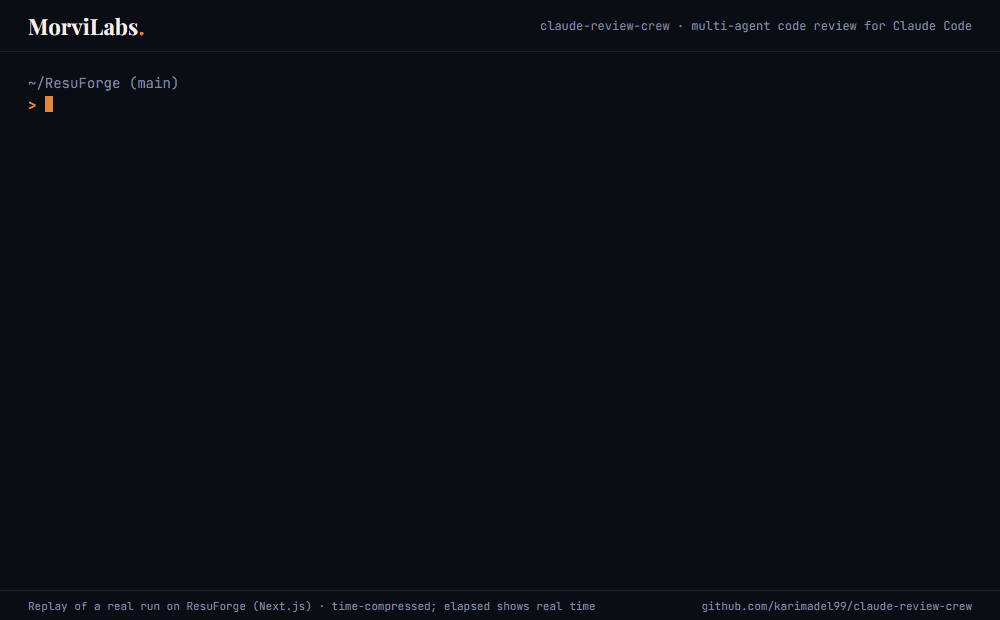

<p align="center">
  
  
  
</p>

<h1 align="center">claude-review-crew</h1>
<p align="center"><em>Ten specialists. One ranked report. Every PR.</em></p>

A Claude Code plugin that runs a real code review the way a senior team does it: `/review` reads the diff and sends it to only the specialists the change needs, all in parallel; the orchestrator then dedupes their findings, ranks them by severity, and hands back one verdict. Built for full-stack JavaScript and TypeScript (React, Next.js, Vue, and Node APIs) by a tech lead who reviews React/TypeScript PRs daily. It detects your stack and adds framework-specific checks on top of the general ones. RTL layout checks run on every UI change; an Arabic summary is one setting away.

<p align="center">
  
</p>
<p align="center"><sub>Replay of a real run on ResuForge (Next.js, 24 files): 9 specialists in 2:41, merge in 3:47. Time-compressed.</sub></p>

## Install

This repo is also the MorviLabs plugin marketplace. Add it, then install:

```bash
claude plugin marketplace add karimadel99/claude-review-crew
claude plugin install claude-review-crew@morvilabs
```

Inside Claude Code the same two steps are `/plugin marketplace add karimadel99/claude-review-crew` and `/plugin install claude-review-crew@morvilabs`.

**For a whole team:** add `--scope project` to both commands and commit `.claude/settings.json`. It records the marketplace and enables the plugin for that repo.

**Try it without installing:**

```bash
git clone https://github.com/karimadel99/claude-review-crew
claude --plugin-dir ./claude-review-crew
```

**Update:**

```bash
claude plugin marketplace update morvilabs
claude plugin update claude-review-crew@morvilabs
```

Installed, it adds about 1k tokens to every session (agent and command descriptions). The specialists load only when `/review` runs them.

## Use

```
/review                 # your branch vs default branch, committed or not
/review 128             # a PR number (uses gh)
/review v1.2.0..main    # a commit range, e.g. everything since a release
/review staged          # git diff --cached
/review src/features/   # a path, reviewed whole
/review-quick           # single-pass mode for small diffs
```

If something else already owns `/review` in your setup, use the full name: `/claude-review-crew:review`.

## What the crew does

| Agent | Looks for |
|---|---|
| `review-orchestrator` | Merges the specialists' findings: dedupes, ranks by severity, writes the report and verdict |
| `review-correctness` | Logic errors, edge cases, state bugs, async/race issues |
| `review-code-quality` | Duplicated logic, tangled functions, loose types that spread, framework misuse, dead code |
| `review-security` | Injection, authz gaps, secrets, XSS, unvalidated input, JWT and session flaws |
| `review-performance` | N+1 requests and queries, re-renders, bundle weight, blocking work |
| `review-api-contract` | Client and server vs the API contract (OpenAPI, generated client, shared schemas): drift, nullables, enums, breaking changes |
| `review-tests` | Missing/weak tests, untested branches and 4xx paths, brittle mocks |
| `review-ux-a11y` | Keyboard paths, ARIA, contrast, RTL breakage (UI changes only) |
| `review-architecture` | Layering shortcuts, cross-feature/package imports, circular deps, server code in the client, reinvented helpers |
| `review-dependencies` | Advisories, typosquats, deprecated packages, lockfile drift, duplicate or heavy additions |
| `review-production` | Error handling, env var wiring, logging, build config, CI changes, migrations, graceful shutdown |

Every finding follows one format — severity, file:line, failure scenario, fix — defined in [`skills/review-rubric`](skills/review-rubric/SKILL.md). No praise sections, no vague "consider improving".

## Stacks

Every specialist runs general JavaScript/TypeScript checks, plus extra checks for each stack detected from your `package.json`:

| Stack | Detected from | Adds checks for |
|---|---|---|
| `react` | `react` | Effects and stale closures, re-renders, keys, error boundaries |
| `next` | `next` (includes `react`) | Server vs client components, server actions, middleware matchers, caching, hydration |
| `vue` | `vue`, `nuxt` | Reactivity loss, watchers vs computed, `v-html`, composables, Nuxt runtime config |
| `node` | `express`, `fastify`, `@nestjs/core`, `hono`, `koa` | Input validation, mass assignment, JWT, transactions, ORM N+1, graceful shutdown, migrations |

In a monorepo the stack is detected per touched package, so one review can cover a Next.js app and its Node API together. Dependency auditing supports npm, pnpm, and yarn.

## Configure

`review.config.json` at your repo root:

```json
{
  "stack": "auto",
  "bilingual": false,
  "openapi_spec": "./openapi.json",
  "max_findings": 25
}
```

- `stack`: `"auto"` (default) detects from `package.json`. Pin it when detection guesses wrong, e.g. `["next", "node"]`.
- `bilingual`: `true` adds an Arabic summary ahead of the English report and treats RTL breakage as blocking.
- `openapi_spec`: path to your spec. Without it, the API contract reviewer looks for a spec, a generated client, or shared schemas on its own.

## Severity

`P0` blocker · `P1` major · `P2` minor · `P3` nit — any P0/P1 → **REQUEST CHANGES**.

## Want this tuned for your team?

Stack-specific rubric, custom specialists, CI integration, and a one-hour team walkthrough. [Get in touch](mailto:karim.adel9922@gmail.com).

---
<p align="center">— <strong>MorviLabs.</strong> · built by <a href="https://github.com/karimadel99">Karim Adel</a></p>
